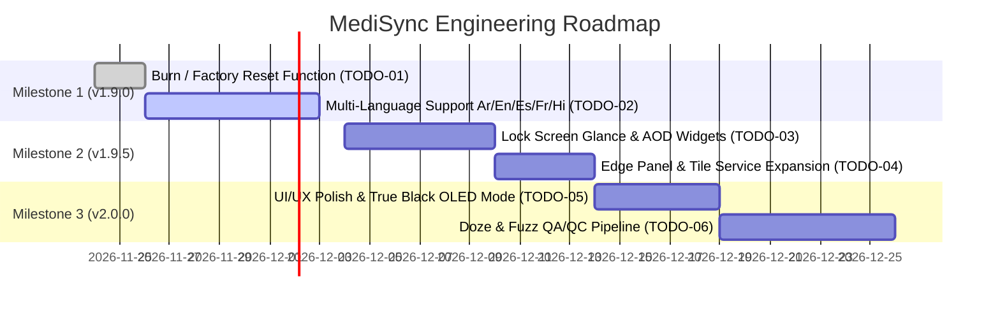

# MediSync — Engineering Roadmap & Technical TODO Specification
**Document Version:** 1.0.0 (Post-v1.8.14 Baseline)  
**Author:** Abdalaziz Adil Badawi & MediSync Core Engineering  
**Scope:** Post-v1.8.14 Feature Backlog, Architecture Enhancements, System Integrations & QA Matrix  
**Classification:** Product Roadmap / Technical Implementation Specification  

---

## 🧭 Executive Overview

This document formalizes the prioritized backlog and technical implementation roadmap for **MediSync** beyond the current baseline (**v1.8.14**). Each backlog item is defined with its clinical and engineering rationale, technical prerequisites, architectural design, implementation steps, difficulty classification, and estimated effort in developer-hours.

```
┌───────────────────────────────────────────────────────────────────────────────┐
│                           MEDISYNC ROADMAP PILLARS                            │
├─────────────────────┬─────────────────────┬───────────────────────────────────┤
│  Data Sovereignty   │  Global Reach       │  Deep Device Integration          │
│  "Burn / Reset"     │  Multilingual i18n  │  Glance Lockscreen & Tiles        │
├─────────────────────┼─────────────────────┼───────────────────────────────────┤
│  Visual Excellence  │  Rigorous QA & QC   │  Clinical Decision Support        │
│  UI/UX Polish       │  Doze & Fuzz Tests  │  Adherence Intelligence           │
└─────────────────────┴─────────────────────┴───────────────────────────────────┘
```

---

## 📊 Summary Implementation Matrix

| Task ID | Feature / Module | Category | Difficulty | Estimated Effort | Priority | Target Release |
|---|---|---|---|---|---|---|
| **TODO-01** | **Burn Data / Factory Reset Function** | Data Sovereignty | **Medium** | **4 – 6 Hours** | **P0 (Critical)** | v1.9.0 |
| **TODO-02** | **Multi-Language Support (Ar, En, Es, Fr, Hi)** | Localization (i18n) | **High** | **24 – 32 Hours** | **P1 (High)** | v1.9.0 |
| **TODO-03** | **Lock Screen Glance & Under-Clock Widget** | Android / One UI | **Very High** | **18 – 24 Hours** | **P1 (High)** | v1.9.5 |
| **TODO-04** | **Edge Panel & Quick Settings Tiles Polish** | Android System | **Medium** | **8 – 12 Hours** | **P2 (Medium)** | v1.9.5 |
| **TODO-05** | **UI/UX Visual Refinement ("Improving Your Eye")** | Design System | **Medium** | **12 – 16 Hours** | **P2 (Medium)** | v2.0.0 |
| **TODO-06** | **Exhaustive QA & Quality Control (QC) Pipeline** | Quality Assurance | **High** | **20 – 28 Hours** | **P1 (High)** | Continuous |

---

## 🛠️ Detailed Feature Specifications

---

### TODO-01: "Burn / Factory Reset" Function (Total User Sovereignty)

#### 1. Overview & User Scenario
Provides a secure, permanent, 1-tap "nuclear wipe" function inside the Profile & Settings page. This allows users to:
1. Reset the app to pristine state as if just downloaded from the store (re-triggering the onboarding wizard).
2. Cleanly purge all personal clinical records, dosages, schedules, and emergency contacts before uninstalling the application or handing the phone to another person.
3. Guarantee zero data residue across both Flutter storage layers and native Android subsystems.

#### 2. Technical Breakdown
- **Hive Box Destruction**:
  - `_medicationsBox.clear()`
  - `_settingsBox.clear()`
  - Purge encrypted keys and delete underlying `.hive` files from disk.
- **Alarm & Notification Cancellation**:
  - Invoke `NotificationService.cancelAllNotifications()` to cancel all recurring Android alarms scheduled via `AlarmManager` (`exactAllowWhileIdle`).
- **Native Android SharedPreferences Wipe**:
  - Invoke platform channel method `burnAllNativeData` in `MainActivity.kt` to clear:
    - `patient_name`, `emergency_health_id`, `blood_type`, `chronic_conditions`, `allergies`
    - `address`, `emergency_contact_name`, `emergency_contact_phone`, `emergency_contact_relation`
    - Pending lockscreen widget data & AOD cache.
- **System Integration Unlinking**:
  - Clear sync flags for Samsung Health, device calendar, and offline ICS cache.
- **App State Reset**:
  - Reset all Riverpod state notifiers to default.
  - Navigate seamlessly via `Navigator.pushAndRemoveUntil` to `OnboardingPage()`.

#### 3. Safety & Confirmation Guardrails
- **Modal Location**: Danger Zone at the bottom of `ProfilePage`.
- **Confirmation Protocol**:
  - Prominent red warning dialog detailing permanent data loss.
  - Two-step confirmation: requires typing `"BURN"` or confirming via biometric prompt (Fingerprint / Face ID).

- **Difficulty Level:** **Medium**  
- **Estimated Effort:** **4 – 6 Hours**  
- **Prerequisites:** `StorageService`, `NotificationService`, `DeviceIntegrationService`, Platform Channel.

---

### TODO-02: Multi-Language Support (Arabic, English, Spanish, French, Hindi)

#### 1. Overview & Rationale
MediSync’s clinical mission requires universal linguistic accessibility. A patient in Riyadh, Madrid, Paris, or Mumbai must be able to read medication instructions, emergency medical ID cards, and drug interaction alerts in their native tongue without confusion.

#### 2. Scope of Languages
1. **Arabic (`ar`)** — *Right-to-Left (RTL)*: Full bidirectional UI mirroring, Arabic numeral localization, Islamic / Hijri calendar options.
2. **English (`en`)** — *Left-to-Right (LTR)*: Current production baseline.
3. **Spanish (`es`)** — Latin America & European clinical terminology.
4. **French (`fr`)** — Healthcare monograph terminology.
5. **Hindi (`hi`)** — Devanagari script rendering, phonetically natural dosage cues.

#### 3. Technical Breakdown
- **Flutter i18n Architecture**:
  - Configure `l10n.yaml` and Flutter's official `flutter_localizations` package.
  - Implement `.arb` translation catalogues:
    - `app_en.arb` (baseline)
    - `app_ar.arb` (Arabic)
    - `app_es.arb` (Spanish)
    - `app_fr.arb` (French)
    - `app_hi.arb` (Hindi)
- **Bidirectional & RTL Layout Architecture**:
  - Ensure all layout widgets use `Directionality.of(context)` and `EdgeInsetsDirectional.fromSTEB` rather than hardcoded left/right paddings.
  - Mirror icons that convey direction (chevrons, back arrows, progress bars) while preserving clinical symbols (pills, shields, crescents).
- **Clinical Database Localization**:
  - Translate dosage forms (e.g., Tablet → قرص / Comprimé / Pastilla / गोली).
  - Translate timing cues (e.g., "Empty Stomach" → "على معدة فارغة" / "En ayunas").
  - Translate critical allergy warning tiers (Red Alert, Amber Caution).
- **Language Switcher**:
  - Add language selector card in `ProfilePage` with instant hot-reload switching without restarting the app.

- **Difficulty Level:** **High**  
- **Estimated Effort:** **24 – 32 Hours (3 Sprints)**  
- **Prerequisites:** String externalization, `flutter_localizations`, RTL UI regression testing.

---

### TODO-03: Lock Screen Glance Widget & Under-Clock Quick Access

#### 1. Overview & Problem Statement
On Android 14/15 and Samsung One UI 6/7, Samsung restricts the native under-the-clock lock screen area to a first-party application whitelist (Clock, Weather, Samsung Health). Currently, MediSync provides:
- A working Lock Screen Corner Shortcut (`EmergencyCardShortcutActivity`).
- An Edge Panel / App shortcut.
- Samsung Good Lock (LockStar) integration instructions.

The goal is to deliver an automated, native-feeling under-the-clock Glance Widget experience that displays live dose countdowns and 1-tap logging directly on the lock screen and Always On Display (AOD).

#### 2. Technical Breakdown
- **Jetpack Glance Widget Implementation**:
  - Migrate legacy Android AppWidgetProvider to modern **Android Jetpack Glance** (`androidx.glance:glance-appwidget`).
  - Build composable glance layouts:
    - Single-row compact capsule layout for under-clock slots.
    - Two-row detailed layout displaying medicine name, dosage, and dose countdown timer.
- **Samsung One UI 7 LockStar Protocol Analysis**:
  - Reverse-engineer and implement Samsung's LockStar third-party widget provider intent receiver.
  - Register `<meta-data android:name="com.samsung.android.appwidget.category" android:value="lockscreen" />` in `AndroidManifest.xml`.
- **Zero-Latency Live Clock Synchronizer**:
  - Implement Android `Chronometer` or Glance-native `Time` component so the countdown decrements second-by-second on the lock screen without draining battery or waking the application processor.
- **Lock Screen Bypass Action**:
  - Refine `EmergencyCardActivity` window flags (`FLAG_SHOW_WHEN_LOCKED`, `FLAG_TURN_SCREEN_ON`, `setShowWhenLocked(true)`) so the emergency card opens instantly over the keyguard with 0 ms latency.

- **Difficulty Level:** **Very High**  
- **Estimated Effort:** **18 – 24 Hours**  
- **Prerequisites:** Android Jetpack Glance, Kotlin coroutines, Samsung Remote Test Lab (RTL) or physical Galaxy S25 FE.

---

### TODO-04: Edge Panel & Quick Settings Tiles Refinement

#### 1. Overview
Enhance MediSync's existing Android Quick Settings Tile (`MediSyncTileService.kt`) and explore a dedicated Samsung Edge Panel provider to give users rapid, one-handed access to today's schedule from anywhere on their device.

#### 2. Technical Breakdown
- **Dynamic Quick Settings Tile**:
  - Update tile state dynamically:
    - **Active (Tile.STATE_ACTIVE)**: Dose due now. Tapping marks dose as taken immediately via background Service without opening the full UI.
    - **Inactive (Tile.STATE_INACTIVE)**: Next dose in *X* hours. Tapping opens Today schedule view.
    - **Unavailable (Tile.STATE_UNAVAILABLE)**: All doses for today complete ("Today We're Done!").
- **Samsung Edge Panel Provider**:
  - Integrate Samsung SLOOK SDK (Samsung Edge Framework) or modern Android floating window overlay.
  - Display a scrollable mini-agenda of today's morning, afternoon, and bedtime medications on the edge strip.

- **Difficulty Level:** **Medium**  
- **Estimated Effort:** **8 – 12 Hours**  
- **Prerequisites:** `MediSyncTileService.kt`, Android BroadcastReceivers, Hive background instance.

---

### TODO-05: UI/UX Aesthetic Refinement ("Improving Your Eye")

#### 1. Overview & Design Vision
Elevate the visual presentation, ergonomic touch targets, micro-animations, and visual accessibility across the entire app to deliver an Apple Design Award-tier clinical experience.

#### 2. Technical Breakdown
- **Fluid Micro-Interactions**:
  - Hero transitions when expanding medication cards from list to detail.
  - Interactive "Confetti / Sparkle" burst when completing all daily doses and earning streak milestones.
  - Subtle spring physics for bottom sheets and dialog dismissals.
- **Enhanced Dark Mode Modes**:
  - Add **OLED True Black (`#000000`)** mode alongside the current Deep Obsidian Slate (`#0B1120`) for maximum battery savings on Samsung AMOLED displays.
- **Accessibility & Low-Vision Optimization**:
  - Verify WCAG 2.1 AAA contrast ratios across all text colors and clinical alert banners.
  - Refine dynamic typography scaling from 0.85x up to 1.35x without pixel overflow or clipped card borders.
  - Integrate device haptic feedback (`HapticFeedback.lightImpact()`, `mediumImpact()`) on dose confirmations, sliders, and date pickers.
- **Visual Tidiness**:
  - Unify card elevation and soft drop shadows using cohesive 4-point design system tokens (`AppTheme.cardElevation`, `AppTheme.clinicalBorder`).

- **Difficulty Level:** **Medium**  
- **Estimated Effort:** **12 – 16 Hours**  
- **Prerequisites:** `AppTheme.dart`, Flutter animation controllers, accessibility scanner tools.

---

### TODO-06: Exhaustive Quality Assurance (QA) & Quality Control (QC) Pipeline

#### 1. Overview
Establish an enterprise-grade automated and manual testing matrix to ensure 99.99% alarm reliability, zero battery drain, and flawless crash-free execution in production.

#### 2. Technical Breakdown
- **Doze Mode & Battery Benchmark Testing**:
  - Test exact alarm execution across prolonged Android Doze (`adb shell dumpsys deviceidle force-idle`).
  - Measure standby battery consumption over a 48-hour period with 6 scheduled medication alarms (target: < 0.8% battery per 24 hours).
- **Timezone & Daylight Saving Edge Cases**:
  - Automated tests simulating device travel across timezones (e.g., UTC+3 to UTC-5).
  - Verify dosage interval preservation (ensuring a 12-hour antibiotic does not fire 6 hours early due to clock changes).
- **Clinical Fuzz Testing Harness**:
  - Build a script to generate 5,000 synthetic patient profiles with randomized allergies, chronic conditions, and prescription drugs.
  - Verify that the clinical cross-referencing engine catches 100% of contraindicated pairs (e.g., Penicillin-Amoxicillin, Warfarin-Ibuprofen) with zero unhandled exceptions.
- **End-to-End Flutter Integration Tests**:
  - Implement full workflow automation tests using `package:integration_test`:
    - Full Onboarding → Add Medicine → Schedule Calculation → Alarm Fired → Dose Taken → Continuity Record Exported.

- **Difficulty Level:** **High**  
- **Estimated Effort:** **20 – 28 Hours**  
- **Prerequisites:** Flutter `integration_test`, Android ADB automation harness, Python fuzz data generator.

---

## 📈 Milestone Roadmap & Sequencing



---

## 📝 Document History

| Version | Date | Author | Summary of Changes |
|---|---|---|---|
| **1.0.0** | 2026-11-23 | Abdalaziz Adil Badawi | Initial formalization of post-v1.8.14 roadmap covering Factory Reset, Multilingual i18n, Lock Screen Glance, UI/UX polish, and QA/QC matrix. |
